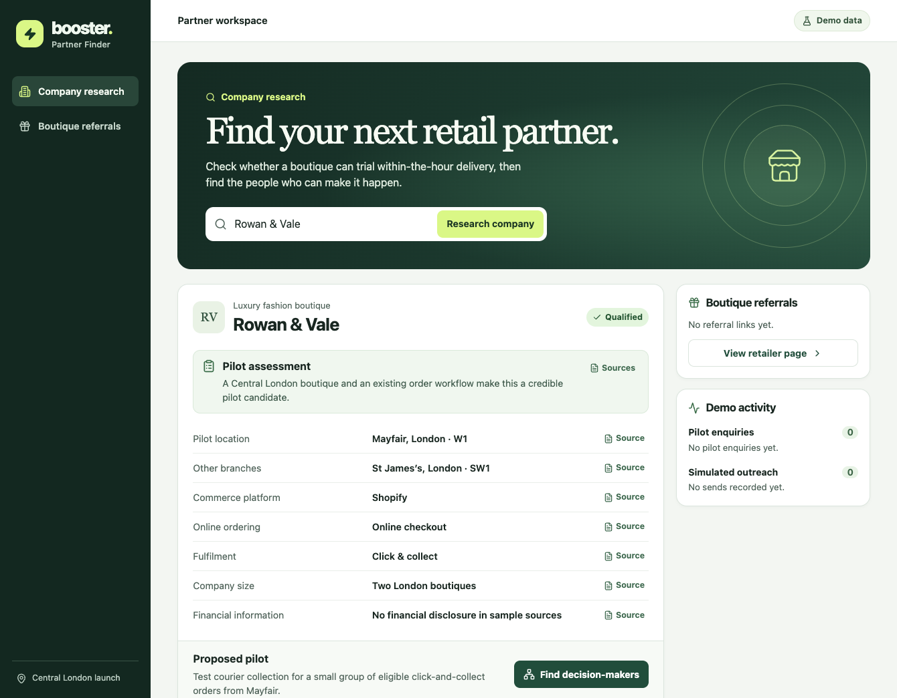
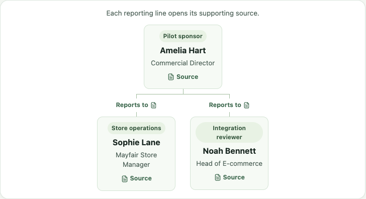
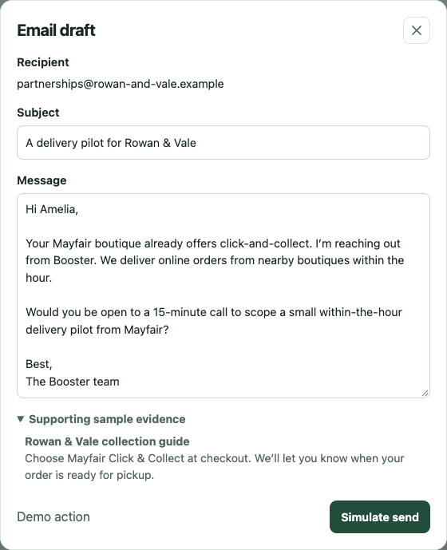
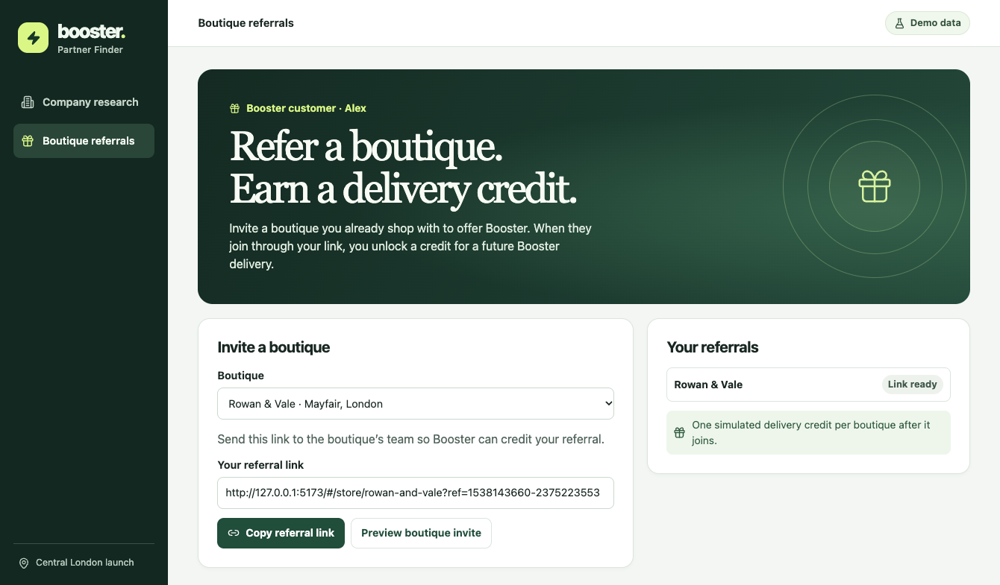
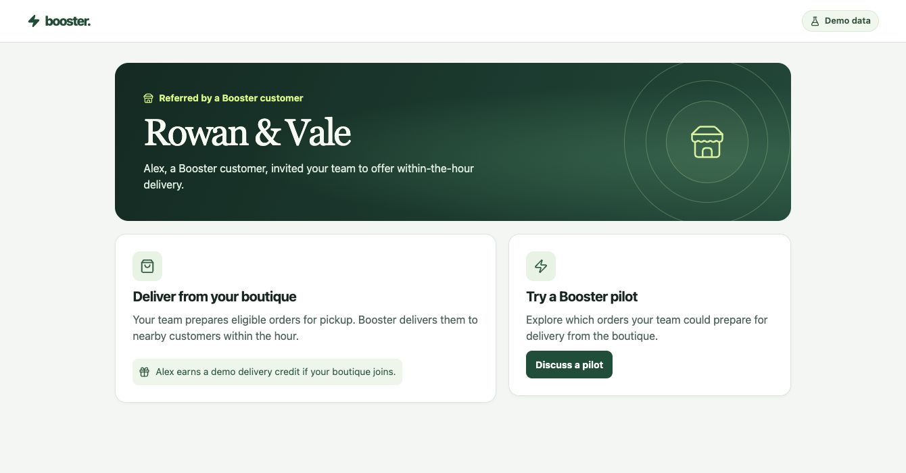
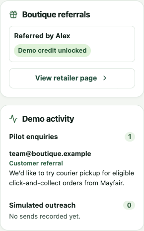

# Booster Partner Finder Screenshots of the web app here

### Company research and outreach

**Check the boutique’s fit.** Search for a company and inspect the evidence behind the qualification decision.



**Find the people who can move the pilot forward.** The decision map shows the pilot sponsor, store operations lead, and integration reviewer alongside their source-backed reporting lines.



**Review a personalised draft.** The email uses the boutique’s collection workflow to propose a small delivery pilot.



### Customer referrals

**Create a boutique referral link.** An existing Booster customer chooses a boutique and shares a personal invite.



**Let the retailer enquire.** The invite explains Booster’s delivery service and gives the boutique a way to ask about a pilot.



**Attribute the enquiry and unlock the credit.** Booster sees the customer referral in its workspace. The customer earns a simulated credit when Booster marks the boutique as joined.



A local hackathon web app for finding boutiques that could trial within-the-hour delivery and letting existing Booster customers refer their favourite stores.

## Critical path

The screenshots show the fictional Rowan & Vale boutique and the simulated referral programme.

## Run locally

Use Node.js 22 and npm.

```sh
npm ci
npm run dev
```

Open the URL printed by Vite. Run `npm run build` to type-check and build the app.

## Demo

1. Search for **Rowan & Vale**. Review the fit decision and open a sample source.
2. Select **Find decision-makers** and inspect a reporting line. Use **Email & LinkedIn** for written outreach or **In-person introductions** for a role-specific meeting request.
3. Go to **Boutique referrals** as demo customer Alex, pick the boutique, and create a referral link. Open **Preview boutique invite** in another tab in the same browser.
4. Use **Discuss a pilot** with a sample work email. Return to **Company research** to see the attributed enquiry, then select **Mark boutique joined** to unlock Alex’s simulated delivery credit.

**Studio Lichen** qualifies with WooCommerce and has a team inbox. **Forma Arc** needs review. **Sable Letter** is low fit.

Companies, people, source excerpts, and delivery credits are fictional. Referral links, enquiries, and simulated sends are saved in local browser storage and shared across tabs on the same origin. Use the same browser for the customer, retailer, and Booster views to demonstrate attribution. Clear this site's browser storage to reset the demo.
